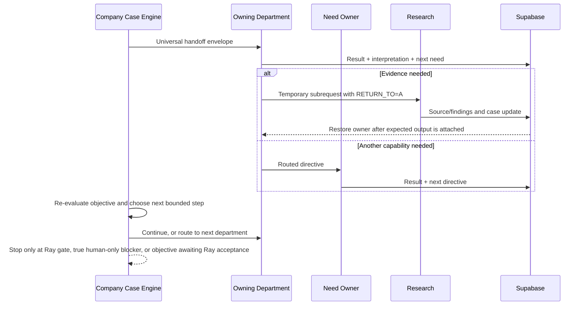

# Nexus Company Workflow Map v1

## Purpose and source of truth

This map extends the existing Company Case Engine. The Company Case remains the parent objective and durable state in `research_runtime_states` / Supabase. Department requests, results, learning records, Systems incidents and existing approval records remain the child work and evidence stores. This document and its JSON registry describe routing behavior; neither creates a parallel case queue.

## Universal invariant

`DEPARTMENT_TASK_COMPLETE != COMPANY_CASE_COMPLETE`. A completed child task returns a result packet, interpretation/learning where known, and a next owner/directive. A negative result, missing source, provider failure, insufficient evidence or partial result keeps the parent active. Parent termination or denial requires the existing Ray approval authority. Objective evidence may be presented for Ray acceptance; an AI department does not mark the parent complete.

## Standard transition



## Handoff and result envelope

`request_department_work` and `request_case_research` now attach a `workflow_handoff` containing case/objective identity, source and target department, directive ID, reason, context, known/unknown items, relevant results/history, questions/work, expected output, success criteria, `return_to`, return condition, cost/resource implication and Ray approval flag. A returned result packet gets a `workflow_result` with summary, result, interpretation, change/explanation/learning, recommendation, recommended changes, next owner/directive, return target and case status. The engine also persists current owner/directive/waiting/expected-output fields for reload.

## Routing by need

The canonical rule set is in `data/governed/nexus_company_routing_rules_v1.json`. Routing is by need type; unknowns default to Research. Authentication, technical and infrastructure needs route to Systems; money, cost, ROI to Finance; creative assets to Creative; campaigns/customer acquisition to Marketing; backtests to Trading; validation/canaries to Labs; public funding/credit evidence to Clyde/Funding; approvals to Ray Review.

## Department maps

The registry contains 24 runtime identities sourced from `intelligence_fabric.DEPARTMENTS`, Research department charters, case-engine names and existing approval/operations paths. Several identities are aliases or specialized entry points to the same owner (for example TRADING/TRADING_RESEARCH to Mercury; FUNDING/CLYDE_CREDIT to Clyde; FINANCE/LEDGER_FINANCE to Finance). See the JSON registry for each identity's accepted inputs, responsibilities, ownership boundaries, outputs, valid next departments, return behavior, escalation conditions, work source and health signals.

## Continuous work and health

Existing department engines remain the work generators; the workflow registry points to each source. The Research runtime continues to select active case questions when its legacy task queue is empty. The existing Systems `run_system_health_loop` now runs a deterministic company workflow check over heartbeat, active cases, questions and queue depth. It opens/refreshes an idempotent `systems_incidents` record when the daemon is alive but active case questions have no active queue item, with root cause, bounded repair direction and post-repair validation.

## Execution boundaries observed in this pass

- Real owner: Research daemon and case continuation.
- Trading: Mercury and existing replay/experiment history.
- Systems: existing health loop, provider registry, work orders and incident store.
- Finance, Marketing, Creative, Labs, Clyde, Alpha, Hermes and Admin/Ray Review use the existing domain runtimes listed in the registry.
- A complete Department A → Department B → Research → return-to-B → B-result → next-department execution was not demonstrated in this pass. The Wick Systems handoff now persists `RETURN_TO=RESEARCH` and its expected output in Supabase, but Systems has not returned its result. The certification therefore marks the cross-department chain partial and does not treat a schema or mapped route as proof of execution.

## Safety and Ray gate

No external publishing, spend, live trading, key rotation or paid cloud resource modification occurred. The OCI config file exists locally, but neither OCI CLI nor OCI Python SDK was available for an inventory call; current cost exposure is unknown. Only the existing governed Ray approval path may authorize parent stop/denial or stage approval.

## Creative media execution and storage authority

Creative work orders route through the bounded Creative Execution Router.
Model/provider selection is delegated to the existing Model Manager when a
model is required. Generated output remains temporary until the deterministic
Asset Persistence Bot verifies its canonical Cloudflare R2 object, records
compact provenance in Supabase through the Data Governor path, links the
campaign, and records a receipt. R2 owns media bytes; Supabase owns metadata
and workflow/business state. See
[`NEXUS_CREATIVE_EXECUTION_AND_STORAGE_R1.md`](NEXUS_CREATIVE_EXECUTION_AND_STORAGE_R1.md)
and decision `NEXUS_STORAGE_ARCHITECTURE_R2_CANONICAL_MEDIA_R1` in the Systems
Ledger.

## Governed agent and capability control plane

The canonical identity chain is:

```text
NOVA (company coordinator)
  ↓
DOMAIN LEADS (Research, Alpha, Clyde, Mercury, Marketing, Creative, Systems, Commerce)
  ↓
REGISTERED MICROBOTS (one bounded responsibility each)
  ↓
SKILLS + CONNECTORS + MODEL PROFILES (separate registries; deny by default)
  ↓
EXECUTION ENVIRONMENT ROUTER (only allowed and currently healthy environments)
  ↓
GOVERNED PERSISTENCE (R2 media bytes; Supabase metadata/business/workflow state)
  ↓
HANDOFF / RESULT PACKET (AI workers do not terminate the parent workflow)
```

Registry files are `configs/nexus_agent_control_plane.json`,
`configs/nexus_skill_registry.json`, the existing
`configs/connector_registry.json`, `configs/nexus_model_profile_registry.json`,
and `configs/nexus_execution_environment_registry.json`. Enforcement and
selection checks live in `scripts/nexus_agent_platform/agent_control_plane.py`.
This control plane does not add a workflow engine; n8n / Workflow Fabric remains
a later implementation phase. A registration is not an activation or health
certificate. Current unverified providers/environments remain unroutable.

Runtime placement remains split: Nova/Hermes uses the Oracle runtime; Research orchestration and Alpha use the Mac Research runtime. The registry does not grant Nova Research-host execution or grant Alpha Oracle execution. Oracle service presence is recorded separately from protocol health.

On 2026-11-17, authenticated Hermes MCP initialization and tool discovery
passed for Research (9 tools) and Nexus (154 tools) through the approved Oracle
resolver. This certifies endpoint discovery, not blanket tool permission or
model/browser generation availability.
