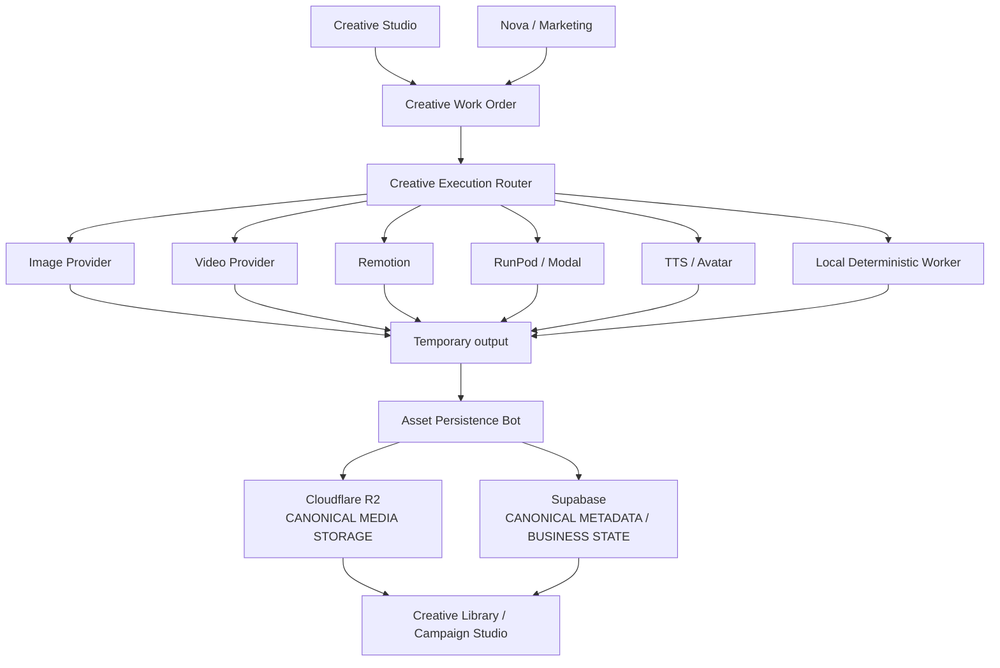

# Nexus Creative Execution and Storage

## Authority

- **Cloudflare R2 = canonical media bytes.** The canonical object key and
  content hash identify an object; public URLs are not canonical references.
- **Supabase = canonical metadata and business/workflow state.** `creative_assets`
  carries compact provenance and campaign linkage; media bytes do not enter
  database columns.
- **Execution environments = temporary producers.** They cannot mark an asset
  complete before canonical ingestion.

## Flow

## Execution and model selection

`creative.execution_router` chooses a verified execution environment by asset
type, approval, and bounded work-order context. It does not call a provider.
When a model is required, `resolve_model_profile` delegates model/provider
selection to the existing Nexus Model Manager (`scripts.model_router` through
`creative.model_router`). Deterministic copy/storyboard generation uses the
explicit `DETERMINISTIC_NO_MODEL` profile.

The current verified active producer is the local deterministic worker for
copy and storyboard JSON only. Remotion is gated by an approved license and
runtime check. Modal, RunPod, and external media providers are not active
Creative routes absent adapter/health evidence. None is canonical storage.

## R2 key and access contract

Canonical key:

`creative/{brand_id|unbranded}/{campaign_id}/{asset_id}/v{version}/master.{ext}`

Identifiers are bounded path-safe values. R2 is configured through server-side
credentials only. Signed reads expire after at most one hour (default fifteen
minutes). Delete requires a verifier-backed approval; no default deletion
authority exists. No Supabase Storage fallback is permitted.

## Persistence completion gate

A work order is complete only when generation succeeded, the object was
uploaded or hash-deduplicated in R2 and verified by metadata/head, the asset
metadata write succeeded through the Supabase egress/Data Governor path, the
campaign relationship exists, and a generation/persistence receipt exists.
Otherwise the campaign remains blocked/retriable and temporary output is not
represented as a Creative Library asset.

## Limits

The `nexus-creative-assets` Standard bucket was created and verified through
Wrangler on 2026-11-17. Non-secret account and bucket values are registered in
the canonical Nexus runtime environment. A temporary Wrangler object passed
PUT, GET, SHA-256, and DELETE checks. The bucket remains private by default;
the custom-domain list is empty and public r2.dev access is disabled.

The canonical `.venv-agent-platform` includes `boto3`, but a bucket-scoped R2
S3 access key is not yet registered. Live adapter ingestion, Supabase metadata
registration, deduplication, and signed URL delivery remain uncertified until
that credential is configured. Operation and registered-object receipts
provide bounded local usage visibility; account-wide Cloudflare usage and
billing are not inferred.
