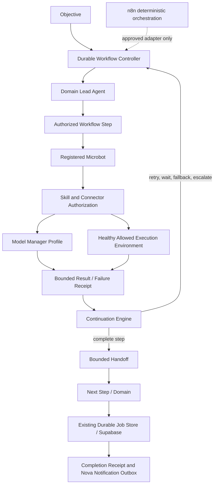

# Nexus Workflow Fabric R1

Status: controller and contracts implemented; production worker dispatch is not activated.

The root workflow envelope is stored on an existing `nexus_durable_jobs` row under `governance_context.workflow_fabric`; no parallel workflow database is introduced. The controller owns status transitions. Workers may return only step outcomes and cannot mark a workflow complete, cancelled, or terminal-failed.

`NEXUS_BUSINESS_TO_CAMPAIGN_R1` defines 15 steps. Campaign publication, spend, client contact, production deployment, database migration, and live trading remain gated. The GoClear certification instance is persisted and currently waits at `OBJECTIVE_INTAKE` for registered worker dispatch and fresh runtime health evidence. No worker step was executed.

n8n on Contabo (2.45.6) passed authenticated read-only health and bounded workflow-list calls (5 workflows). The Nexus adapter has writes disabled. Outbound n8n-to-Nexus connectivity and n8n persistence backend are not certified. Six cronbot contracts exist but are not scheduled.

Integration contracts define Research Room event references, certified-only marketing measurement, competitive intelligence source gating, and Creative production through Asset Persistence to R2 and Supabase metadata. Contracts do not claim that unavailable producers/connectors are active.
